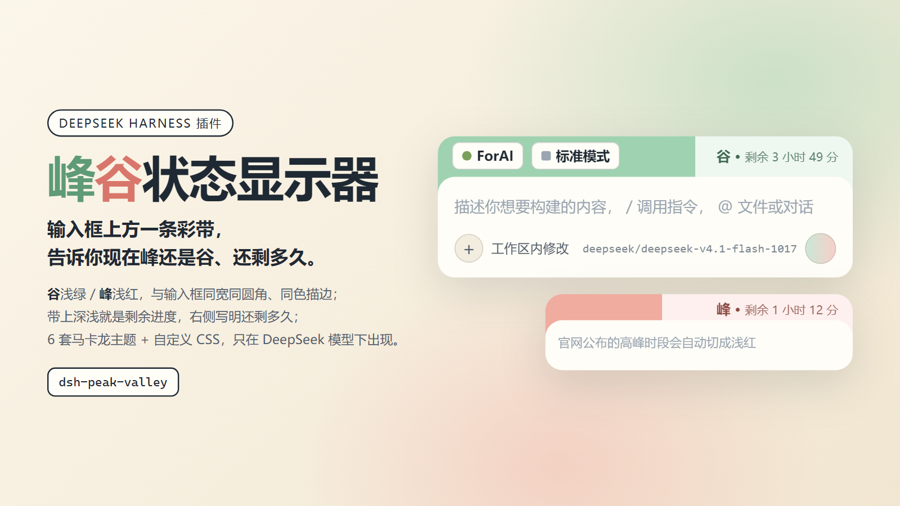

# dsh-peak-valley · 峰谷状态显示器



在 DeepSeek Harness 的输入卡片正上方加一条「峰 / 谷」状态带：**只在当前模型是 DeepSeek 时出现**，谷为浅绿、峰为浅红，带内是剩余时长进度，右侧显示还剩多久。

## 判定标准

官方口径（DeepSeek「模型 & 价格」页）：**北京时间周一至周五（不含中国法定节假日）9:00–12:00、14:00–18:00 为高峰时段；其余时段，包括周末及中国法定节假日全天均为空闲时段。**

- **峰**：工作日落在高峰窗口内。
- **谷**：高峰窗口之外的一切 —— 午休 12:00–14:00、18:00 之后到次日 9:00、周末全天、法定节假日全天（含调休拼出来的连续假期）。
- 调休补班日不做特殊处理：**补班安排在周末的，依旧算谷**。官方只认「周一至周五 / 周末 / 法定节假日」，不认国务院的补班表，所以内置数据里刻意不存补班日期。
- 「非工作时间」在本插件里等价于上面的谷：官方没有第三档时段，谷就是峰窗口的补集，不存在独立的「错峰优惠时段」。

内置 2026 年放假安排（国办发明电〔2025〕7 号，33 天假 / 6 天补班，补班部分不影响判定）。其它年份只有周末判定，设置页会提示。

## 显示

- 状态带与输入卡片同宽、同顶圆角，底边用负 margin 藏进卡片，卡片圆角处露出带状底色 —— 观感是一块彩色圆角矩形上叠着白色圆角卡片。
- 输入卡片描边跟随主色（改 `--dsw-elevation-stroke-color`，不动哈希类名）。
- 深浅分界 = 本阶段剩余时长百分比；右侧「峰 · 剩余 N天N小时」，与左侧的项目/模式选择对称，不再另给标签底色。
- 文字默认比可见带略高（`--pv-lift`），避免贴到卡片边上。

### 与宿主尺寸绑定

不写死像素：宿主改主题或改字号，状态带跟着变。

| 状态带上的量 | 绑定到 |
| --- | --- |
| 藏进卡片的深度 `--pv-tuck` | `--dsw-radius-panel` + 2px（输入卡片圆角 + 肩部余量） |
| 上下圆角 | 下沿用 `--dsw-radius-panel`；首屏上沿 `--pv-hero-radius: min(--dsw-radius-panel, 行高 × .55)`，薄条上不会塌成半圆 |
| 字号 / 可见高度 | `clamp(11px, .75em, 13px)` + `calc(1em + 14px)`，跟系统基准字号走 |
| 宽度 / 与卡片的间距 | `--dsh-composer-side-clearance`、`--dsh-composer-card-max-width`、`--dsh-composer-stack-gap` |

首屏（hero）里「项目 / 模式」那一行会叠在带上：条向上量到那一行顶部，行高、抬升量、文字内边距全部运行时实测写入 CSS 变量，窗口缩放、侧栏开合、首屏↔会话切换都会立刻重量（ResizeObserver + MutationObserver，400ms 节流）。

## 设置

设置 → 峰谷：

- **主题**：抹茶 / 樱花 / 苏打 / 奶油 / 丁香 / 雾蓝，都是马卡龙浅色。
- **高峰时段**：两行 9:00–12:00、14:00–18:00（北京时间），可改；其余时间自动算谷。
- **自定义 CSS**：追加在基础样式之后，按文档顺序覆盖，无需 `!important`。

自定义钩子：

| 选择器 / 变量 | 作用 |
| --- | --- |
| `:root{--pv-c-valley / --pv-c-peak}` | 谷 / 峰主色，同时驱动状态带与卡片描边 |
| `.pv-bar{--pv-band / --pv-tuck / --pv-lift}` | 可见高度 / 藏进卡片的深度（`--pv-tuck` 要不小于卡片圆角半径）/ 文字上移量 |
| `.pv-bar[data-hero]{--pv-hero-radius}` | 首屏叠色时的上沿圆角，默认跟随输入框圆角 |
| `.pv-bar[data-phase="peak"]`、`[data-phase="valley"]` | 只覆盖某一阶段 |
| `--pv-pct` | 运行时写在 `.pv-bar` 上的剩余百分比，样式里可直接引用 |
| `.pv-phase`、`.pv-remain` | 右侧的阶段字与剩余时长 |

示例：

```css
:root{ --pv-c-valley:#c8ecd8; --pv-c-peak:#ffb3ab }
.pv-bar[data-hero]{ --pv-hero-radius:20px }
.pv-remain{ font-weight:600 }
```

## 安装

### 方式一：GUI 安装框（推荐）

设置 → 插件 → 安装，填入包名：

```
dsh-peak-valley
```

### 方式二：命令行

```bash
dsh plugin --profile desktop add dsh-peak-valley
```

### 方式三：让助手装

对助手说「装 dsh-peak-valley」，它会调用 `plugin_manager action=install_bundle target=dsh-peak-valley`。注意 `install_bundle` 是模型工具而不是 shell 命令，`npm i` 只改依赖、不登记 `dsh.profile.bundles`，不能当安装手段。

### 本地目录（开发用）

`install_bundle` 同样接受一个绝对路径（例如 `F:\ForAI\dsh-peak-valley`），会以 `link:` 方式挂进 profile，改完刷新页面即可。

装好之后**刷新 Web GUI 页面**（客户端模块随页面加载）。若是替换已安装的同名包，需要重启 DSH 桌面端才会加载新的模块版本。

## 生效范围

- 只在 Web GUI 里生效（桌面端与浏览器打开的是同一套 Web 前端，两边都管用）。
- 只有当前会话的模型 provider 或模型名命中 `deepseek` 时才显示；换成别家模型，状态带直接消失。
- 新对话与进行中的对话都会出现；首屏时它与「项目 / 模式」那一行共用一条背景，进入会话后那一行不在，状态带独占一行。

## 兼容性与已知限制

- 内置节假日只有 2026 年；其它年份只按周末判定（设置页会提示）。
- 官方价格页若调整高峰时段，需要改代码里的默认峰窗口，或直接在设置里改时段。
- 定位依赖 `conversation.input.dock` 插槽与 `data-composer-card` 属性。上游若换掉这套契约，最坏表现是状态带不再出现，不会误伤其他交互。
- 判定用固定 UTC+8，不随系统时区变化 —— 官方口径本来就是北京时间。
- 与走网关 / 中转的 DeepSeek 模型兼容（按名称匹配），但同名转售的第三方模型也会被点亮。

## 位置与实现

注册在 `conversation.input.dock`（输入卡片上方的 dock 列表，会话级），`order: 60` 排在队列面板之下、紧贴卡片。模型信息取自 `ctx.get("modelDirectories").directoryFor(sessionId).store`，provider 或模型名命中 `deepseek` 即生效。

设置项存 `localStorage` 的 `dsh-peak-valley:settings`，不引入宿主配置。

## 工程

- `assets/icon.svg` 矢量图标（暖色底、深色描边，与 dsh-rightbar-tab-gestures、dsh-cloudflare-media 同一套视觉语言），衍出 1024/512/256/128/64 PNG；`assets/cover.html` → `assets/cover-1600x900.png` / `cover-3200x1800.png`，全部由 `assets/render.mjs`（CDP 固定布局视口）渲染。
- `locale/zh.json`、`locale/en.json` 提供中英文标题与简介。
- 发布：推 `v*` tag 触发 `.github/workflows/release.yml`，npm trusted publishing（OIDC）+ provenance，Release 正文由 `scripts/release-notes.mjs` 从 `CHANGELOG.md` 生成。
- `npm test` 只做 `node --check`：这个包没有运行时依赖，也没有可单测的纯函数出口。
